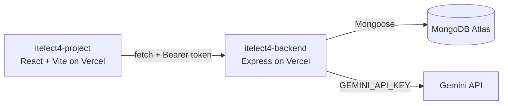

[](https://github.com/xyrusgeluz/itelect4-backend/actions/workflows/ci.yml)

## Architecture



# Campus Lost & Found Tracker — Backend (`itelect4-backend`)

REST API backend for the **Campus Lost & Found Tracker**, built with **Node.js, Express 5, TypeScript, MongoDB Atlas (Mongoose)**, and **Google Gemini 2.0 Flash AI** via `@google/genai`.

Part of **ITELECT4 (Web Development) — Graded Task 5 (GT5)** at De La Salle Lipa.

---

## Live Deployments & Repositories

| Component | URL |
|---|---|
| **Live Backend API** | [https://itelect4-backend-lovat.vercel.app](https://itelect4-backend-lovat.vercel.app) |
| **Live Frontend App** | [https://itelect4-project-six.vercel.app](https://itelect4-project-six.vercel.app) |
| **Backend Repository** | [https://github.com/xyrusgeluz/itelect4-backend](https://github.com/xyrusgeluz/itelect4-backend) |
| **Frontend Repository** | [https://github.com/xyrusgeluz/itelect4-project](https://github.com/xyrusgeluz/itelect4-project) |

---

## Features

- **JWT Authentication & Password Hashing**:
  - `POST /api/auth/register` — User creation with bcrypt password hashing (10 salt rounds) and uniqueness validation.
  - `POST /api/auth/login` — JWT issuance (2-hour expiry) using `JWT_SECRET`.
- **Items Management (CRUD)**:
  - `GET /api/items` — Public list of all lost/found items sorted newest first.
  - `GET /api/items/:id` — Public single-item retrieval.
  - `POST /api/items` — Protected route (requires Bearer token) where `postedBy` is extracted from verified JWT payload.
  - `PATCH /api/items/:id` & `DELETE /api/items/:id` — Protected item modification scoped to item owner.
- **AI-Powered Item Report Review (`POST /api/ai`)**:
  - Integrated with **Google Gemini (`gemini-flash-latest`)** via `@google/genai`.
  - **Structured JSON Output**: Gemini response is constrained by a JSON Schema compiled from Zod (`reviewSchema`).
  - **Strict Validation**: Checks response through 3 sequential filters (`!text`, `JSON.parse`, `reviewSchema.safeParse`).
  - **Rate Limiting**: Protected with `express-rate-limit` capped at **5 requests/minute per user account** (`keyGenerator: req.userId`).
  - **Prompt Injection Defense**: User text is strictly delimited within `<submission>` tags and system prompt directs model to treat content as untrusted input.
  - **Reliable Error Handling**: Maps quota exhaustion to `429` and upstream Gemini failures to `502 Bad Gateway`.
- **Serverless-Ready Architecture**:
  - MongoDB connection pooling via promise-singleton (`src/config/db.ts`).
  - Native Vercel serverless function export (`src/app.ts`).

---

## Tech Stack

- **Runtime & Language**: Node.js, TypeScript
- **Framework**: Express 5
- **Database & ODM**: MongoDB Atlas, Mongoose 9
- **AI Integration**: Google Gemini SDK (`@google/genai`), Zod, JSON Schema
- **Security & Utilities**: `jsonwebtoken`, `bcryptjs`, `express-rate-limit`, `cors`, `dotenv`
- **Development Tooling**: `tsx` (hot-reloading TS runner)

---

## Folder Structure

```
itelect4-backend/
├── src/
│   ├── ai/
│   │   ├── gemini.ts       # Gemini client singleton, buildContents(), reviewProject()
│   │   └── prompt.ts       # SYSTEM_PROMPT, MODEL, wrap(), and few-shot EXAMPLES
│   ├── config/
│   │   └── db.ts           # MongoDB connection singleton (serverless-compatible)
│   ├── data/
│   │   └── items.ts        # Seed data items
│   ├── middleware/
│   │   └── auth.ts         # requireAuth JWT verification & type augmentation
│   ├── models/
│   │   ├── User.ts         # User Mongoose model (bcrypt hook, toJSON transform)
│   │   ├── Item.ts         # Item Mongoose model (lost/found)
│   │   └── Claim.ts        # Claim Mongoose model
│   ├── routes/
│   │   ├── auth.ts         # /api/auth (register, login)
│   │   ├── items.ts        # /api/items (CRUD)
│   │   └── ai.ts           # /api/ai (rate-limited, protected Gemini review)
│   ├── schemas/
│   │   └── review.ts       # Zod schemas (aiRequestSchema, reviewSchema, reviewJsonSchema)
│   ├── types/
│   │   └── index.ts        # Core TypeScript interfaces & document types
│   ├── app.ts              # Express app setup & route mounting (Vercel default export)
│   ├── server.ts           # Local development server entry point
│   ├── seed.ts             # Database seeder (admin & sample items)
│   └── try-ai.ts           # Standalone terminal CLI test for Gemini integration
├── .env.example
├── package.json
└── tsconfig.json
```

---

## Environment Variables

Create a `.env` file in the root of `itelect4-backend`:

```env
MONGODB_URI=your_mongodb_connection_string
JWT_SECRET=your_jwt_secret_key
PORT=4000
CORS_ORIGIN=http://localhost:5173,https://itelect4-project-six.vercel.app
GEMINI_API_KEY=AIzaSy...
```

> **Note**: `GEMINI_API_KEY` is server-side only and must **never** be committed to git or exposed to the client.

---

## Local Installation & Setup

1. **Clone the repository**:
   ```bash
   git clone https://github.com/xyrusgeluz/itelect4-backend.git
   cd itelect4-backend
   ```

2. **Install dependencies**:
   ```bash
   npm install
   ```

3. **Configure environment**:
   ```bash
   cp .env.example .env
   # Fill in MONGODB_URI, JWT_SECRET, and GEMINI_API_KEY
   ```

4. **Seed the database** (optional):
   ```bash
   npm run seed
   ```

5. **Test the Gemini AI integration directly**:
   ```bash
   npm run try-ai
   ```

6. **Start development server**:
   ```bash
   npm run dev
   # API runs on http://localhost:4000
   ```

7. **Compile & Typecheck**:
   ```bash
   npm run typecheck
   npm run build
   ```

---

## API Endpoints

| Method | Endpoint | Protection | Description |
|---|---|---|---|
| `GET` | `/api/health` | Public | API health check & MongoDB connection status |
| `POST` | `/api/auth/register` | Public | Register a new user |
| `POST` | `/api/auth/login` | Public | Authenticate user & return JWT token |
| `GET` | `/api/items` | Public | List all items (sorted newest first) |
| `GET` | `/api/items/:id` | Public | Get single item details |
| `POST` | `/api/items` | **Bearer JWT** | Create an item (owner from token) |
| `PATCH` | `/api/items/:id` | **Bearer JWT** | Update item (owner only) |
| `DELETE` | `/api/items/:id` | **Bearer JWT** | Delete item (owner only) |
| `POST` | `/api/ai` | **Bearer JWT** | Generate structured AI review (rate-limited 5/min) |
